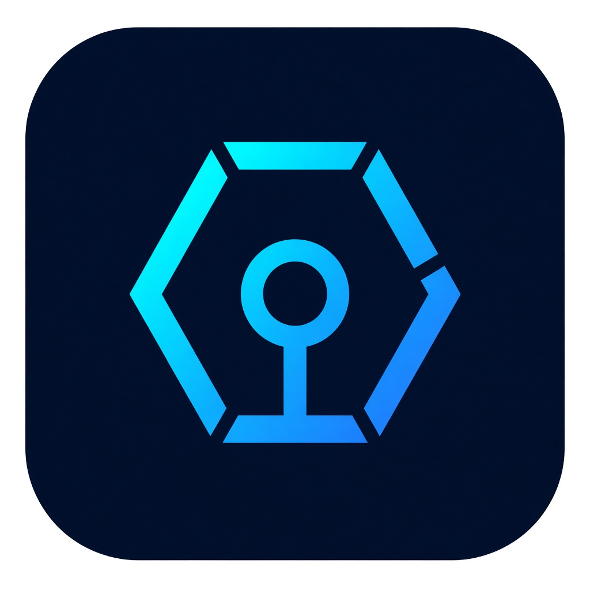

<p align="center">
  
</p>

<h1 align="center">AgentiChain</h1>

<p align="center">
  A multi-agent command center that turns a plain-language contract request into Solidity, tests, an audit, a local deployment, and a public testnet broadcast.
</p>

AgentiChain is a portfolio product for showing how a smart-contract workflow can be run from one screen. An engineer describes what the contract should do. A small set of agents writes a formal spec, Solidity, Foundry tests, and a deploy script. Slither scores the draft. Foundry runs the tests. The same project can then be deployed to a local Anvil chain or broadcast to a public testnet, with the runtime bytecode checked against what was compiled.

The client-facing path was exercised end to end on this machine: synthesis, formal spec, Solidity, Slither, Foundry, local Anvil deploy and verify, keeper probe, telemetry, and a live Base Sepolia broadcast with explorer verification.

## Why it matters

Writing a contract, reviewing it, testing it, and deploying it usually means jumping between an editor, a terminal, an explorer, and a wallet. AgentiChain keeps that sequence in one command center so a client can watch the work happen:

1. The request is turned into roles, invariants, and functions.
2. Solidity, an interface, Foundry tests, and a deploy script are produced together.
3. A static audit and a real `forge test` run against those files.
4. A local chain proves the bytecode before any public network is touched.
5. A separate, explicit action broadcasts to a selected public network.

Private keys never enter the Flutter app. The signer lives only in `backend/.env` on the machine that runs the API. The interface shows chain, address, block, and verification status. It does not show credentials, model names, or vendor endpoints.

## What you can show

| Step | What the client sees |
| --- | --- |
| Sign in | Anvil wallet session on chain `31337`, or a browser wallet signature when an injected wallet is available |
| Synthesize | A contract request becomes a spec, Solidity, tests, and a deploy script |
| Formal spec | Roles, invariants, functions, and errors |
| Solidity | Core contract, interface, Foundry test, and `Deploy.s.sol` |
| Architecture | Agent path: architect, Solidity, auditor, Foundry, gas |
| Security | Live Slither score with findings and a suggested patch |
| Foundry | A fresh `forge test` run, with pass and fail counts |
| Local deploy | Broadcast to Anvil, then runtime bytecode verification |
| Keepers | Anvil event subscription and a pause probe that raises events |
| Telemetry | API, database, Foundry, Anvil, Slither, keeper, and wallet session health |
| Public broadcast | Deploy to the network selected in the header, then verify on that chain |

A live example from the Base Sepolia run:

- Contract: [`0x9b73883cfa4D90e335712deD326C2Dd2EeC27999`](https://sepolia.basescan.org/address/0x9b73883cfa4D90e335712deD326C2Dd2EeC27999)
- Chain id: `84532`
- Block: `47165315`

## Features

- **Seven-step command center.** Projects, synthesis, formal spec, Solidity, architecture, security, Foundry, deploy, keeper bots, and telemetry.
- **LangGraph pipeline.** The synthesis graph runs architect, then Solidity, auditor, Foundry, and gas. Each node records what it produced.
- **Live Foundry.** Compile and test use a real Foundry project written from the generated files, not a canned pass count.
- **Live Slither.** The auditor runs Slither on the generated sources and returns a score plus findings.
- **Local Anvil.** Deploy, bytecode verify, and keeper subscriptions use chain `31337`. Keepers do not attach to public networks.
- **Public networks.** The header can target Base, Base Sepolia, Ethereum, Sepolia, Arbitrum One, Arbitrum Sepolia, Optimism, Optimism Sepolia, Polygon, Avalanche, and BNB Chain. Each chain has an HTTPS RPC and a fallback. `PUBLIC_RPC_URL` or `RPC_URL_<chainId>` can override that RPC.
- **Two-step broadcast.** Local Anvil and the selected public network are separate buttons. Public broadcast stays off until `ALLOW_PUBLIC_BROADCAST=true`. Mainnet also requires `ALLOW_MAINNET=true`.
- **Bytecode verification.** After deploy, the API reads the on-chain runtime code and compares it with the compiled artifact.
- **Explorer submit.** When `ETHERSCAN_API_KEY` is set, source verification is submitted through Etherscan API v2. Local Anvil is skipped.
- **Wallet sessions.** Anvil sign-in uses the well-known local demo account. Browser sign-in asks the injected wallet for `personal_sign`, recovers the address on the server, and stores only a hashed bearer token.
- **Saved projects.** SQLite stores projects, files, pipeline runs, deployments, and audit results across restarts.
- **Health and telemetry.** `/api/health` reports Foundry, Anvil, Slither, LangGraph, keeper mode, and whether public broadcast is armed.

## How it is built

The product is split so the interface cannot hold a signer.

```text
Flutter command center  -->  FastAPI  -->  Foundry / Slither / Anvil
                                 |
                                 +--> SQLite
                                 +--> public HTTPS RPC (only when broadcast is armed)
                                 +--> explorer verification (only when an API key is set)
```

A request enters through Flutter. FastAPI validates it, writes a Foundry job on disk, and runs the toolchain. LangGraph orders the agent nodes. The Solidity node emits the contract, the interface, the tests, and the deploy script as one set of files. The auditor and Foundry nodes then run on those files. Deploy uses `forge create`. Verification reads runtime bytecode back from the chain. Public deploy refuses the Anvil demo key, so a throwaway deployer in `backend/.env` is required.

The earlier Next.js screens in `agentic-ai-smart-contract-platform` were the first interface prototype. The command center clients see now is the Flutter app in `apps/agentichain`.

A coding assistant was used as a helper to move faster and keep the API, the Flutter screens, and the toolchain calls consistent. The product shape, the safety gates, and the verification of each step were engineering decisions on this repository.

## What was used

| Layer | Tools |
| --- | --- |
| Interface | Flutter (web), Dart, `provider`, `http` |
| API | Python, FastAPI, Pydantic, Uvicorn |
| Data | SQLAlchemy async, SQLite |
| Agents | LangGraph |
| Contracts | Solidity `0.8.24`, OpenZeppelin contracts where the generated draft needs them, Foundry (`forge`, `anvil`) |
| Audit | Slither |
| Signatures | `eth-account` for EIP-191 recovery; browser `personal_sign` when a wallet extension is present |
| Public chains | HTTPS JSON-RPC, Foundry `forge create`, Etherscan API v2 for source submission |
| Optional planner | An OpenAI-compatible chat API, used only when `OPENAI_API_KEY` is set |

## Run it

The API and the Flutter app are separate processes. Start the API first.

### API

```powershell
cd backend
py -3.11 -m venv .venv
.\.venv\Scripts\Activate.ps1
pip install -r requirements.txt
copy ..\env.example .env
uvicorn app.main:app --reload --host 127.0.0.1 --port 8000
```

Health check: [http://127.0.0.1:8000/api/health](http://127.0.0.1:8000/api/health)

Foundry is downloaded into the local tool cache on first use if `forge` is not already on `PATH`. Slither is installed with the Python requirements.

### Flutter command center

From `apps/agentichain`, with Flutter installed:

```powershell
flutter pub get
flutter run -d chrome --dart-define=API_BASE=http://127.0.0.1:8000
```

For an Android emulator, point the app at the host loopback:

```powershell
flutter run -d emulator --dart-define=API_BASE=http://10.0.2.2:8000
```

### Public broadcast

Fill these in `backend/.env` only. Do not put them in Flutter.

```text
DEPLOYER_PRIVATE_KEY=0x...
ALLOW_PUBLIC_BROADCAST=true
ETHERSCAN_API_KEY=
```

`DEPLOYER_PRIVATE_KEY` must be a throwaway key, never the Anvil demo key. Fund that address on the testnet you select. `ALLOW_MAINNET` stays `false` unless a demo is intentionally aimed at a mainnet and the deployer is funded there. Portfolio demos should stay on Base Sepolia.

Copy `env.example` for the full list. Secrets are not returned by the API.

## Safety boundaries

- The Anvil demo key is accepted only on chain `31337`.
- Keeper bots subscribe to Anvil only.
- Public broadcast is off until `ALLOW_PUBLIC_BROADCAST=true`.
- Mainnet chain ids stay blocked until `ALLOW_MAINNET=true`.
- Generated Solidity is a draft. The audit and Foundry run are there so a client can see the draft get checked before it is broadcast.
- `backend/.env`, local databases, and the tool cache are gitignored.

## Scope of this repository

This repository is the command center that was tested above: Flutter, FastAPI, Foundry, Slither, Anvil, wallet sessions, and public testnet broadcast.

`REDIS_URL` and `ORACLE_CLOUD_HOST` are reserved settings for a later worker queue and a hosted machine. They are not required to run or demonstrate the command center. Browser-wallet sign-in needs a browser profile that allows a wallet extension. Anvil sign-in is the path that works without one.
